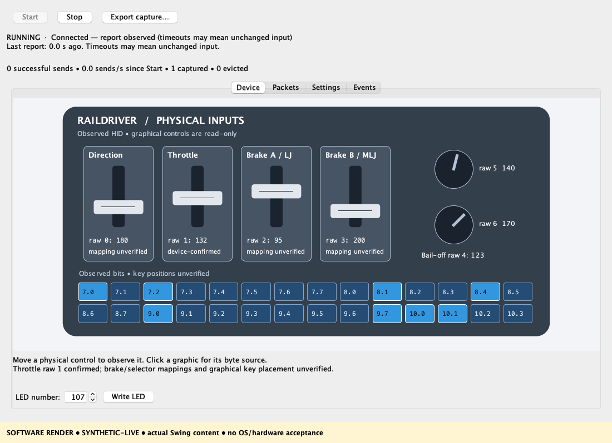

# Java RailDriver gateway

Java 17+ console gateway and Swing workbench for the RailDriver controller. Preserves the existing simulator's 20-byte UDP interface; the original VB.NET project remains unchanged.



*Software render with synthetic inputs. Physical mappings marked unverified still require confirmation.*

## Build and run

Install a **JDK 17+** and **Maven**, connect the controller, then run from the repository root:

```sh
mvn -f RailDriverJava/pom.xml clean verify
java -jar RailDriverJava/target/raildriver-gateway.jar --gui
```

Select **Start** to connect and **Stop** to disconnect. Omit `--gui` for console mode; use `--help` for usage. On JDK 24+, add `--enable-native-access=ALL-UNNAMED` before `-jar`.

Run only one gateway at a time. Stop VB.NET before starting Java, and vice versa. The JAR includes native dependencies; USB access still depends on host permissions.

## Workbench

- **Device:** read-only input graphic, change highlighting, byte details and LED tests (0–999).
- **Packets:** raw 14-byte HID reports and encoded 20-byte UDP frames.
- **Settings:** loopback ports, send delay and diagnostics; load/save properties while stopped.
- **Events / Export capture:** connection diagnostics and CSV export. Export before closing to retain captured data.

The graphic shows observed input, without simulator button assignments or calibration. Throttle raw index 1 is confirmed; other physical mappings and key placement remain unverified. LED write acceptance requires visual confirmation on the controller. Send counts measure local sends, not simulator receipt.

## Default connection

| Purpose | Default |
| --- | --- |
| UDP output | `127.0.0.1:59983` |
| Command listener | `127.0.0.1:59982`, accepting peer `127.0.0.1:59981` only |
| Send delay | Nominal 10 ms |

Three-byte commands: `[81, any, any]` requests shutdown; `[83, b1, b2]` displays unsigned `b1 * 100 + b2`. No output is sent before a valid report. Detected USB loss stops transmission; reconnect manually with Start. Console mode supports Ctrl+C.

## Windows packaging

On native Windows, set `JAVA_HOME` to a full JDK 17+ matching the target architecture and put Maven on PATH:

```powershell
.\RailDriverJava\package-windows.ps1
.\RailDriverJava\dist\RailDriverGateway\RailDriverWorkbench.exe
```

The app image includes a runtime, the GUI launcher above and console launcher `RailDriverGateway.exe`. Copy the **whole** `RailDriverGateway` folder to the target machine. Packaging requires a new destination directory and remains unverified on Windows.

## Verification status

- **Passed:** 32 Java 17 software tests; macOS real-controller HID/UDP, throttle, LED 107, unplug shutdown and session restart checks.
- **Pending:** complete physical mapping, VB.NET equivalence, simulator integration, native GUI click-through and Windows execution.

See [verification/](verification/) for captured evidence. Software renders do not establish hardware or native GUI acceptance.

## Dependencies

Uses hid4java 0.8.0, JNA 5.19.1 and bundled hidapi native libraries. [Dependency notices](src/main/resources/META-INF/raildriver-notices/) are also included in the JAR. Repository licensing, owner permission and redistribution terms require review before release.
